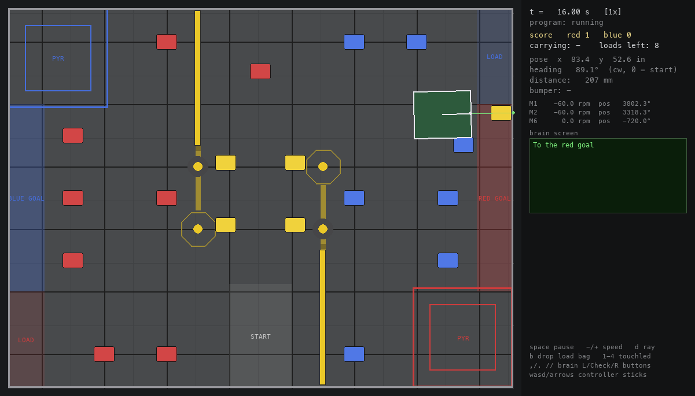

# vexsim — VEX IQ "Level Up" simulator

Practice VEX IQ Python at home without a robot. You write normal
VEXcode-IQ-style Python (`from vex import *`, same classes, same methods),
run it, and a window shows your robot driving on the 2026-27 Level Up field
(Skills layout).

The fake `vex` module mirrors the real VEX IQ 2nd-gen Python API
([api.vex.com/iq2](https://api.vex.com/iq2/home/python/)), so code that works
here transfers to the real robot unchanged. Anything the simulator doesn't
model raises a clear error instead of silently doing nothing.



## Setup

Needs Python 3.12+ and [uv](https://docs.astral.sh/uv/) (`brew install uv`
on macOS).

```sh
git clone https://github.com/thejake/vexiq-levelup-sim.git
cd vexiq-levelup-sim
uv sync
```

## Run a program

```sh
uv run python examples/first_drive.py
```

That's it — importing `vex` relaunches the file under the simulator.
Equivalent long form: `uv run python -m vexsim examples/first_drive.py`.

### VS Code

Open the repo folder (accept the recommended Python extensions), open any
robot program, and press **F5** ("Debug in simulator"). Breakpoints,
stepping, and variable inspection work inside your program — and when you
pause at a breakpoint, the simulation clock pauses with you, so the robot
freezes mid-field until you continue. Two more launch configs in the
dropdown: a 4x-speed variant for skipping long autons, and "Debug simulator
internals" if you want to step into the `vex` module or the physics.
**Ctrl+F5** runs without the debugger, and the default test task
(Tasks: Run Test Task) runs the headless regression suite.

Your code runs against a simulated clock, so pausing (space) pauses your
program, and running at 4x speed runs your `wait()`s at 4x too.

### Keys in the window

| Key | Does |
|---|---|
| space | pause / resume |
| `-` / `=` | slower / faster (0.25x–16x) |
| `d` | toggle the distance-sensor ray |
| `b` | drop a Skills load bag into the red load zone |
| `1`–`4` | press Touch LED 1–4 |
| `,` `.` `/` | brain Left / Check / Right buttons |
| `w a s d` | controller left stick (axisA/axisB) |
| arrows | controller right stick (axisC/axisD) |
| `z x` `n m` `r f` `t g` | controller L / R / E / F button pairs |
| esc | quit |

## Use it as a library (clean workspace)

You don't have to work inside this repo. Make a project that holds only
your robot programs and pull the simulator in as a dependency:

```sh
mkdir my-robot-code && cd my-robot-code
uv init --python 3.12
uv add "vexiq-sim @ git+https://github.com/thejake/vexiq-levelup-sim"
```

Now any `from vex import *` program in that folder runs in the simulator
(`uv run python my_auton.py`), and your workspace is just your own files —
the sim hides in `.venv`. For F5 debugging, add a `.vscode/launch.json`
with the same config this repo uses (module `vexsim`, args `["${file}"]`).
Drop a `simconfig.toml` next to your programs to configure the robot.
Update to the latest simulator with
`uv lock --upgrade-package vexiq-sim && uv sync`.

## What's simulated

- **Drivetrain / SmartDrive** — `drive`, `drive_for`, `turn`, `turn_for`,
  `turn_to_heading`, `turn_to_rotation`, velocities, `set_timeout`,
  `is_done`/`is_moving`, blocking and `wait=False` forms.
- **Motor / MotorGroup** — `spin`, `spin_for`, `spin_to_position`,
  `position`, `velocity`, stopping modes, timeouts. All the constructor
  forms VEXcode generates (`Motor(p)`, `Motor(p, True)`, `Motor(p, 1.5, True)`).
- **Brain** — screen (cursor text + drawing, shown in the side panel; also
  echoed to the terminal), timer, battery, the three IQ2 buttons, sounds
  (printed, `play_note` takes sim time).
- **Inertial / Gyro** — heading (clockwise-positive like the real one),
  rotation, calibrate, acceleration (enough for VEXcode's random-seed code).
- **Distance** — raycast against the perimeter, pyramids, and the thin
  goal/support poles, at the sensor's configured mount height. Bean bags
  and the ramped floor strips are too low to see; the elevated beams are
  visible only if the sensor sits at beam height (~6.25").
- **Bumper** — presses when the robot is pushing against an obstacle.
- **Optical** — reports the color of a bean bag right in front of the robot.
- **Touchled** — color shown in the panel, press with keys 1–4.
- **Controller** — keyboard-driven (see table above).
- **Bean bags** — the intake motor (port set in `simconfig.toml`) grabs the
  bag in front when spinning forward (carries one), ejects on reverse. Loose
  bags get bulldozed. Floor goals score live: 1 point per bag fully inside,
  own color or yellow.
- **Events, Thread, Timer, wait/sleep** — run against the sim clock.

Not modeled (raises `VexSimNotImplemented`): Pneumatic, Vision/AI Vision,
ColorSensor (use Optical), `Thread.stop`. Pyramid goals and posts are solid
obstacles but L1–L4 stacking is not scored (v1).

## Physics honesty

The point is transferable habits, not perfect physics:

- The yellow mid-field "walls" are really **elevated beams** (0.84" rod at
  6.25" — Appendix A): a robot under ~5.8" tall drives beneath them (set
  `height_in` in simconfig). The 0.75" ramped **floor strips** under and
  beyond them are crossable at reduced speed by default (`strips_block`
  makes them solid). The L4 "octagons" are cone tops 24" up — only their
  poles block the robot.
- Driving into something solid stalls you there, forever, exactly like the
  real robot — **set `drivetrain.set_timeout(...)`** like you should anyway.
- Collisions don't slide: wedge a corner against a post mid-turn and the
  turn will never finish (the timeout saves you).
- Turns and drives are near-perfect by default. Turn on noise, wheel slip
  and turn overshoot in `simconfig.toml` (`[realism]`) when you want to
  practice against imperfection.
- **Always pass units explicitly** (`drive_for(FORWARD, 300, MM)`). A few
  VEX default units are unconfirmed in the docs, so code that relies on
  defaults is the one place sim and robot could quietly disagree.

## Configuration

`simconfig.toml` at the repo root: robot size, start pose, which port is
the intake, distance-sensor mount, realism knobs. The file documents every
setting. Robot geometry is configurable so it can be calibrated against the
real robot later.

## Field notes

Geometry is transcribed from the official game manual (v2.1) Appendix A
drawings, cross-checked against the VEXcode VR field image; coordinates
are inches, origin at the bottom-left, X 0–97 along the long side, all in
`vexsim/field.py`. Still unverified: pyramid colors (bottom-right assumed
red), the exact skills start zone, and the support-post base radius
(assumed 2"). Pyramid L1–L4 stacking isn't scored yet (v1). Corrections
welcome — the layout lives in one file.

## Tests

```sh
./tests/run_tests.sh
```

Headless regression suite: API smoke test, a square drive that must close
within tolerance, and a Skills preload run that must score.
